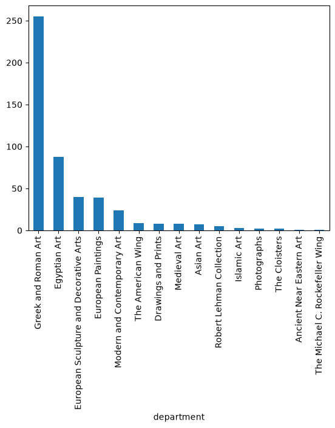
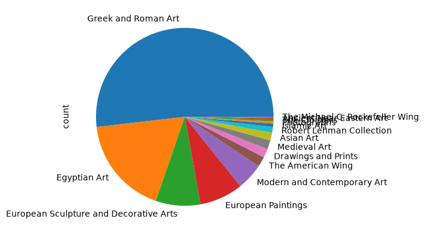
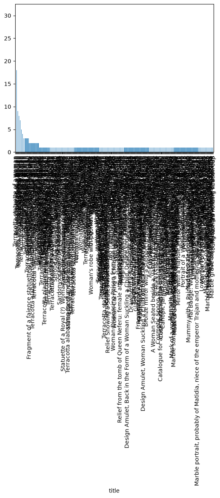
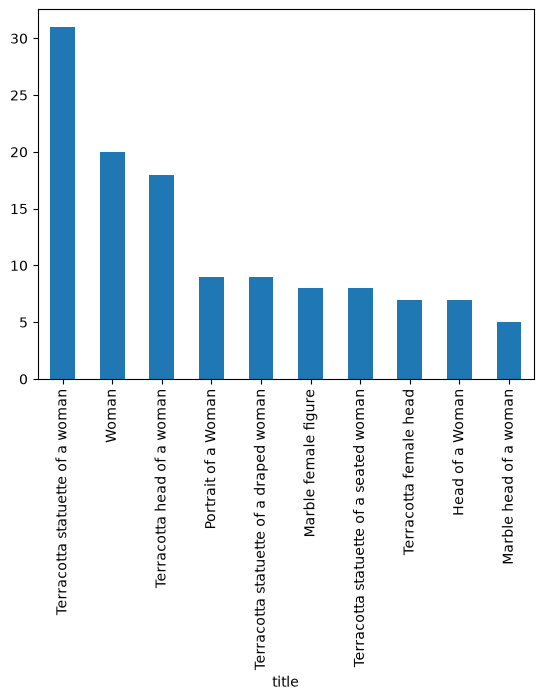
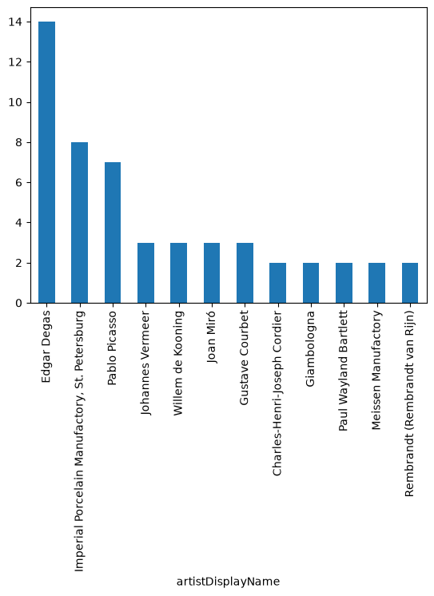
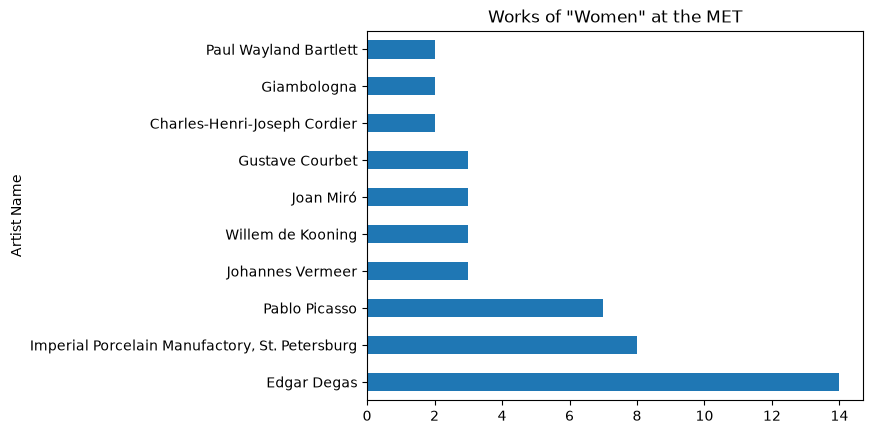



## Part 12: Introduction to Pandas

### What is pandas?

So far, we've worked with tables of data using the tools that come with Python:
the `csv` module to read a file into a list of dictionaries
([Part 7](../part7/)), and loops and `if` statements to filter, count, and sort
that list ([Parts 5 and 8](../part8/)). That works, but it takes a lot of code for
questions like "how many missing values does each column have?" or "what's the
average accession year?"

**pandas** is a Python library built for exactly this kind of work: loading,
exploring, cleaning, and summarizing tables of data. It's one of the most widely
used tools in data analysis. Its two main types are:

- a **DataFrame**, a whole table of rows and columns, much like a spreadsheet or
  the CSV files we've been reading. Each column has a name and a **data type**,
  and each row has a number, called its **index**.
- a **Series**, a single column of a DataFrame: a list of values with an index
  alongside.

pandas isn't part of Python, but it comes with the course environment. If
`import pandas` gives a `ModuleNotFoundError` in a notebook, run
`%pip install pandas` in a cell. The editors on this page already have it.

By convention, pandas is imported under the short name `pd`:

```python
import pandas as pd
```

The dataset in this lesson is `woman_500.csv`, in the course repository's
`week9` folder. It holds 500 objects from the Metropolitan Museum of Art's
collection, collected from the Met's API (the kind of request we made in
[Part 10](../part10/)), whose search matched the word "woman". You'll also find
the matching notebook, `pandas.ipynb`, in the same folder.

### The pandas tools in this lesson

Here is a summary of what we'll use, in the order we meet it:

| Tool | What it does | What it gives back |
| --- | --- | --- |
| `pd.read_csv("file.csv")` | Reads a CSV file | A DataFrame |
| `df` (just the name) | Displays the table | The table, with the middle left out if it's large |
| `df.info()` | Summarizes the columns, their types, and missing values | Prints a summary |
| `df.head()` / `df.tail()` | Shows the first / last rows | A smaller DataFrame |
| `df.shape` | The size of the table | A pair: (rows, columns) |
| `df.columns` | The column names | An index of names |
| `df.drop(...)` | Removes columns (or rows) | A **new** DataFrame |
| `df['name']` or `df.name` | Selects one column | A Series |
| `series.tolist()` | The values of a column | A plain Python list |
| `df[100:105]` | Selects rows by position | A smaller DataFrame |
| `df.describe()` | Summary statistics of the numeric columns | A DataFrame of statistics |
| `df.value_counts('name')` | Counts how often each value appears in a column | A Series, most common first |
| `df.sort_values('name')` | Sorts the rows by a column | A **new** DataFrame |
| `df[mask]` | Keeps only the rows where a True/False test is `True` | A smaller DataFrame |
| `series.str.contains('text')` | Tests whether each text value contains some text | A Series of True/False |
| `series.nlargest(n)` | Keeps the `n` largest values | A smaller Series |
| `.plot(kind='bar')` | Draws a chart | A chart |

Note that `df.shape` and `df.columns` have no parentheses, because they're
**attributes**, pieces of information the DataFrame already holds. The ones with
parentheses, like `df.info()`, are **methods**: actions the DataFrame performs.
(This is the same difference between `len(my_list)` and `my_list.append(...)`.)

### Turning a CSV file into a DataFrame

Here is what the start of `woman_500.csv` looks like as plain text. It has a
header line and then one line per object. Each line has 59 fields, and I've cut
them off after the first 150 characters:

```text
,objectID,isHighlight,accessionNumber,accessionYear,isPublicDomain,primaryImage,primaryImageSmall,additionalImages,constituents,department,objectName, ...
0,483873.0,0.0,1984.613.2,1984,0.0,,,[],"[{'constituentID': 161817, 'role': 'Artist', 'name': 'Willem de Kooning', 'constituentULAN_URL': 'http://voca ...
1,207162.0,0.0,1982.60.281,1982,1.0,https://images.metmuseum.org/CRDImages/es/original/ES6521.jpg,https://images.metmuseum.org/CRDImages/es/web-large/ ...
2,247582.0,0.0,06.1169,1906,1.0,https://images.metmuseum.org/CRDImages/gr/original/DP1224.jpg,https://images.metmuseum.org/CRDImages/gr/web-large/DP12 ...
```

A few things to notice, from what we learned about CSV files in
[Part 7](../part7/):

- The first column has no name (the header starts with a comma). It's a row number,
  saved there when the file was created.
- Some fields are empty: two commas in a row (`,,`) mean a missing value.
- Some fields hold quoted lists and dictionaries, with commas inside them.

`pd.read_csv()` reads the whole file and returns a DataFrame. It handles the
quoting for us, and works out each column's data type. We save the DataFrame in a
variable. By convention it's called `df`:

```python
import pandas as pd

df = pd.read_csv("woman_500.csv")
```

Compare this with Part 7. There we needed `open()`, `csv.DictReader()`, and
`list()` to get a list of dictionaries. pandas does it all in one call.

### Displaying a DataFrame

To look at a DataFrame, we can print it, or in a notebook just type its name at
the end of a cell:

```python
print(df)
```

```text
     Unnamed: 0  objectID  isHighlight  ... isTimelineWork  GalleryNumber  message
0             0  483873.0          0.0  ...            0.0            NaN      NaN
1             1  207162.0          0.0  ...            0.0            543      NaN
2             2  247582.0          0.0  ...            0.0            159      NaN
3             3  283274.0          0.0  ...            0.0            NaN      NaN
4             4  483877.0          0.0  ...            1.0            NaN      NaN
..          ...       ...          ...  ...            ...            ...      ...
495         495  202972.0          0.0  ...            0.0            620      NaN
496         496  338096.0          0.0  ...            0.0            NaN      NaN
497         497  252375.0          0.0  ...            0.0            152      NaN
498         498  545150.0          0.0  ...            1.0            105      NaN
499         499  207191.0          0.0  ...            0.0            538      NaN

[500 rows x 59 columns]
```

With 500 rows and 59 columns, pandas doesn't try to show everything. It shows the
first and last few rows and columns, and uses `...` for the rest. The last line
says how big the full table is.

Some things to notice in the table:

- The numbers on the left are the **index**, the row numbers, starting at `0`.
- `Unnamed: 0` is the unnamed first column from the file.
- `NaN` ("not a number") is how pandas shows a **missing value**, like the empty
  fields in the CSV.

(In a Jupyter notebook, typing `df` shows a nicer, scrollable HTML table instead
of this text.)

<script type="py-editor" config='{"packages": ["pandas"], "files": {"{{ csv_url }}": "./woman_500.csv"}}'>
import pandas as pd

df = pd.read_csv("woman_500.csv")

print(df)
</script>

The first time you press Run on a page like this, it takes a little while to load
pandas. After that it's quicker. The editors may also print a `DeprecationWarning`
about "Pyarrow" above your output. It's a notice about pandas' plans for its next
version, and you can ignore it.

### Getting an overview: info(), head(), and tail()

Three methods give a quick overview of a DataFrame. First, `df.info()`
summarizes the whole table:

```python
df.info()
```

```text
<class 'pandas.core.frame.DataFrame'>
RangeIndex: 500 entries, 0 to 499
Data columns (total 59 columns):
 #   Column                 Non-Null Count  Dtype  
---  ------                 --------------  -----  
 0   Unnamed: 0             500 non-null    int64  
 1   objectID               492 non-null    float64
 2   isHighlight            492 non-null    float64
 3   accessionNumber        492 non-null    object 
 4   accessionYear          489 non-null    float64
 5   isPublicDomain         492 non-null    float64
 6   primaryImage           415 non-null    object 
 7   primaryImageSmall      415 non-null    object 
 8   additionalImages       492 non-null    object 
 9   constituents           129 non-null    object 
 10  department             492 non-null    object 
 ...
 57  GalleryNumber          443 non-null    object 
 58  message                8 non-null      object 
dtypes: float64(11), int64(1), object(47)
memory usage: 230.6+ KB
```

(`info()` prints one line for every column. I've left out the middle here.) For
each column, it shows:

- **Non-Null Count**: how many of the 500 rows have a value there. A column with
  fewer than 500 has missing values. `objectID` has 492, so 8 rows are missing an
  object ID. (Those are IDs the Met's API couldn't find, so those rows hold only
  a message.)
- **Dtype**: the data type. `int64` is a whole number, `float64` is a number with
  a decimal point, and `object` is usually text (or something else that isn't a
  number). Columns of numbers that have missing values are stored as `float64`,
  because `NaN` is a kind of float. That's why `isHighlight` shows as `0.0` and
  `1.0`.

Next, `head()` shows the first rows of the table, and `tail()` shows the last
rows. They show 5 rows unless you give them a number:

```python
print(df.head())
```

```text
   Unnamed: 0  objectID  isHighlight  ... isTimelineWork  GalleryNumber  message
0           0  483873.0          0.0  ...            0.0            NaN      NaN
1           1  207162.0          0.0  ...            0.0            543      NaN
2           2  247582.0          0.0  ...            0.0            159      NaN
3           3  283274.0          0.0  ...            0.0            NaN      NaN
4           4  483877.0          0.0  ...            1.0            NaN      NaN

[5 rows x 59 columns]
```

```python
print(df.tail(3))
```

```text
     Unnamed: 0  objectID  isHighlight  ... isTimelineWork  GalleryNumber  message
497         497  252375.0          0.0  ...            0.0            152      NaN
498         498  545150.0          0.0  ...            1.0            105      NaN
499         499  207191.0          0.0  ...            0.0            538      NaN

[3 rows x 59 columns]
```

Both return a smaller DataFrame, so the row numbers keep their original values:
the tail starts at 497, not 0.

<script type="py-editor" config='{"packages": ["pandas"], "files": {"{{ csv_url }}": "./woman_500.csv"}}'>
import pandas as pd

df = pd.read_csv("woman_500.csv")

df.info()

print(df.head())
print(df.tail(3))
</script>

### Shape and columns

Two **attributes** tell us about the table's structure. `df.shape` is the number
of rows and columns, as a pair, and `df.columns` lists the column names:

```python
print(df.shape)
print(df.columns)
```

```text
(500, 59)
Index(['Unnamed: 0', 'objectID', 'isHighlight', 'accessionNumber',
       'accessionYear', 'isPublicDomain', 'primaryImage', 'primaryImageSmall',
       'additionalImages', 'constituents', 'department', 'objectName', 'title',
       'culture', 'period', 'dynasty', 'reign', 'portfolio', 'artistRole',
       'artistPrefix', 'artistDisplayName', 'artistDisplayBio', 'artistSuffix',
       'artistAlphaSort', 'artistNationality', 'artistBeginDate',
       'artistEndDate', 'artistGender', 'artistWikidata_URL', 'artistULAN_URL',
       'objectDate', 'objectBeginDate', 'objectEndDate', 'medium',
       'dimensions', 'measurements', 'creditLine', 'geographyType', 'city',
       'state', 'county', 'country', 'region', 'subregion', 'locale', 'locus',
       'excavation', 'river', 'classification', 'rightsAndReproduction',
       'linkResource', 'metadataDate', 'repository', 'objectURL', 'tags',
       'objectWikidata_URL', 'isTimelineWork', 'GalleryNumber', 'message'],
      dtype='object')
```

`df.shape` gives `(500, 59)`: 500 rows and 59 columns. `df.columns` is an **Index**,
a list-like object holding the names. These are the names we'll use to select
columns. (`df.keys()` gives the same list.)

<script type="py-editor" config='{"packages": ["pandas"], "files": {"{{ csv_url }}": "./woman_500.csv"}}'>
import pandas as pd

df = pd.read_csv("woman_500.csv")

print(df.shape)
print(df.columns)
</script>

### Modifying a DataFrame: drop()

59 columns is a lot, and some of them we don't need, such as the unnamed row-number
column. The `drop()` method removes columns. We give it the name of the column,
and `axis=1` to say we mean a *column* (`axis=0`, the default, means a row):

```python
filtered_df = df.drop('Unnamed: 0', axis=1)

print(df.shape)
print(filtered_df.shape)
```

```text
(500, 59)
(500, 58)
```

The important thing to notice is that **`drop()` doesn't change `df`**. It returns
a **new DataFrame** with the column removed, and leaves the original as it was:
`df` still has 59 columns and `filtered_df` has 58. That's why we saved the result in
a new variable, `filtered_df`. (If we'd written `df.drop('Unnamed: 0', axis=1)`
without saving the result, the new DataFrame would be thrown away and nothing
would seem to have happened.) Most pandas methods work this way: they hand back a
new object, rather than changing the old one.

#### Dropping several columns with a loop

To remove more columns, we could repeat `drop()` once for each one. A `for` loop
(from [Part 4](../part4/)) over a list of names does that with less code. Each
time through the loop, we drop one column from `filtered_df`, and save the result
*back into* `filtered_df`, so that the next pass starts from the smaller table:

```python
unwanted_columns = ['primaryImageSmall', 'portfolio', 'artistRole']

for column in unwanted_columns:
    filtered_df = filtered_df.drop(column, axis=1)

print(filtered_df.shape)
print('portfolio' in filtered_df.columns)
print('title' in filtered_df.columns)
```

```text
(500, 55)
False
True
```

We started with 58 columns and dropped three, which leaves 55. The `in` operator
(from [Part 1](../part1/) and [Part 2](../part2/)) works on `columns` too, so we can
check that `portfolio` is gone and `title` is still there.

`drop()` can also take the whole list at once, which does the same thing in one
step: `filtered_df = filtered_df.drop(columns=unwanted_columns)`. (With
`columns=`, we don't need `axis=1`.)

<script type="py-editor" config='{"packages": ["pandas"], "files": {"{{ csv_url }}": "./woman_500.csv"}}'>
import pandas as pd

df = pd.read_csv("woman_500.csv")

filtered_df = df.drop('Unnamed: 0', axis=1)

print(df.shape)
print(filtered_df.shape)

unwanted_columns = ['primaryImageSmall', 'portfolio', 'artistRole']

for column in unwanted_columns:
    filtered_df = filtered_df.drop(column, axis=1)

print(filtered_df.shape)
print('portfolio' in filtered_df.columns)
print('title' in filtered_df.columns)
</script>

Try adding another name to `unwanted_columns`, and running it again to see the
shape change. Be careful with spelling: asking `drop()` for a column that doesn't
exist raises a `KeyError`.

### Selecting columns and their values

From here on, we'll use `filtered_df`, the smaller table. Square brackets with a
column's name select that column:

```python
print(filtered_df['title'])
print(type(filtered_df['title']))
```

```text
0                                                  Woman
1                                                  Woman
2                        Terracotta lekythos (oil flask)
3                                                  Woman
4                                                  Woman
                             ...                        
495                          Abduction of a Sabine Woman
496                Susannah and the Elders before Daniel
497    Terracotta alabastron (perfume vase) in the fo...
498                                            Sa Amulet
499                                      The Thrown Kiss
Name: title, Length: 500, dtype: object
<class 'pandas.core.series.Series'>
```

A single column is a **Series**: the values, with the index (the row numbers)
alongside, and a `Name` and `dtype` at the bottom. Like the DataFrame, it shows
just the start and the end.

If you want just the values, without the index, turn the Series into an
ordinary Python list with `.tolist()`:

```python
titles = filtered_df['title'].tolist()

print(type(titles))
print(titles[:10])
```

```text
<class 'list'>
['Woman', 'Woman', 'Terracotta lekythos (oil flask)', 'Woman', 'Woman', nan, 'Woman', 'Woman', 'Woman', 'Woman']
```

That's a regular list from [Part 3](../part3/), so everything we know about lists
applies: indexing, slicing with `[:10]`, `len()`, and loops. Notice the `nan` in
the sixth place: that title is missing.

There's a shortcut for column names that are valid Python names, with no spaces:
`filtered_df.title` is the same as `filtered_df['title']`:

```python
print(filtered_df.title[:5])
```

```text
0                              Woman
1                              Woman
2    Terracotta lekythos (oil flask)
3                              Woman
4                              Woman
Name: title, dtype: object
```

Square brackets always work, though, even for names with spaces. The attribute
shortcut can clash with names pandas already uses (like `df.count`), so brackets
are the safer habit.

#### Slicing rows

Square brackets can also select **rows**. Instead of a name, give them a slice,
which works like a list slice from [Part 2](../part2/) and [Part 3](../part3/): the
first number is included, the last isn't. `filtered_df[100:105]` gives rows 100
to 104:

```python
print(filtered_df[100:105])
```

```text
     objectID  isHighlight  ... GalleryNumber  message
100  555761.0          0.0  ...           109      NaN
101  254747.0          0.0  ...           152      NaN
102  546047.0          0.0  ...           117      NaN
103  468716.0          1.0  ...           301      NaN
104  466235.0          0.0  ...           305      NaN

[5 rows x 55 columns]
```

The result is a smaller DataFrame, and its index keeps the original row numbers
(100 to 104, not 0 to 4). We can slice a column the same way:

```python
print(filtered_df['title'][100:105])
```

```text
100                                     Female Statuette
101    Terracotta plaque with a female figure holding...
102                                       Cosmetic spoon
103        Marble Portrait Bust of a Woman with a Scroll
104                                           Holy Woman
Name: title, dtype: object
```

<script type="py-editor" config='{"packages": ["pandas"], "files": {"{{ csv_url }}": "./woman_500.csv"}}'>
import pandas as pd

df = pd.read_csv("woman_500.csv")

filtered_df = df.drop('Unnamed: 0', axis=1)

unwanted_columns = ['primaryImageSmall', 'portfolio', 'artistRole']

for column in unwanted_columns:
    filtered_df = filtered_df.drop(column, axis=1)

print(filtered_df['title'])
print(type(filtered_df['title']))

titles = filtered_df['title'].tolist()
print(type(titles))
print(titles[:10])

print(filtered_df.title[:5])

print(filtered_df[100:105])
print(filtered_df['title'][100:105])
</script>

Try the other columns, such as `'medium'` or `'department'`, and different
slices.

### Statistics: describe()

`describe()` calculates summary statistics for every **numeric** column at once:

```python
print(filtered_df.describe())
```

```text
            objectID  isHighlight  ...  linkResource  isTimelineWork
count     492.000000   492.000000  ...           0.0      492.000000
mean   338124.420732     0.075203  ...           NaN        0.126016
std    150547.306742     0.263987  ...           NaN        0.332205
min     10112.000000     0.000000  ...           NaN        0.000000
25%    247556.750000     0.000000  ...           NaN        0.000000
50%    253507.000000     0.000000  ...           NaN        0.000000
75%    469534.000000     0.000000  ...           NaN        0.000000
max    897321.000000     1.000000  ...           NaN        1.000000

[8 rows x 10 columns]
```

It returns a DataFrame with a row for each statistic:

| Row | Meaning |
| --- | --- |
| `count` | How many values aren't missing |
| `mean` | The average |
| `std` | The standard deviation: how spread out the values are |
| `min` / `max` | The smallest and largest values |
| `25%`, `50%`, `75%` | The quartiles. `50%` is the median, the middle value |

Text columns are left out, since there's no average of a title. pandas has
shortened the output with `...` again, so some of the 10 numeric columns are hidden.
Several of them (like `linkResource`) have a `count` of `0`: those columns have no
values at all. Comparing each `count` with the 500 rows is a quick way of seeing how
much is missing.

To see the statistics of just one column, use `describe()` on a Series. Here's the
year each object was added to the Met's collection:

```python
print(filtered_df['accessionYear'].describe())
```

```text
count     489.000000
mean     1935.578732
std        37.739216
min      1871.000000
25%      1910.000000
50%      1926.000000
75%      1966.000000
max      2023.000000
Name: accessionYear, dtype: float64
```

This says that of the 489 objects with an accession year, the earliest was acquired in
1871 and the latest in 2023, and half of them were acquired by 1926. (It's worth
looking at other columns too. `objectBeginDate`, the year each object was made, has a
minimum of `-7000`, because dates before the common era are stored as negative
numbers. So its average, though pandas calculates it, isn't very meaningful.)

<script type="py-editor" config='{"packages": ["pandas"], "files": {"{{ csv_url }}": "./woman_500.csv"}}'>
import pandas as pd

df = pd.read_csv("woman_500.csv")

filtered_df = df.drop('Unnamed: 0', axis=1)

unwanted_columns = ['primaryImageSmall', 'portfolio', 'artistRole']

for column in unwanted_columns:
    filtered_df = filtered_df.drop(column, axis=1)

print(filtered_df.describe())

print(filtered_df['accessionYear'].describe())
print(filtered_df['objectBeginDate'].describe())
</script>

### Sorting data: value_counts() and sort_values()

Two questions come up all the time: "which values are the most common?" and "what
comes first?" Two methods answer them.

`value_counts()` counts how many times each value appears in a column, and lists the
most common first. It returns a Series, with the values as its index:

```python
print(filtered_df.value_counts('title'))
```

```text
title
Terracotta statuette of a woman                    31
Woman                                              20
Terracotta head of a woman                         18
Portrait of a Woman                                 9
Terracotta statuette of a draped woman              9
                                                   ..
Marble head of a goddess                            1
Marble head of a girl from a small statue           1
Marble grave stele of a young woman and servant     1
Marble grave stele of a woman                       1
Young woman holding libation cup                    1
Name: count, Length: 332, dtype: int64
```

There are 332 different titles among the 500 objects, and the most common one is
"Terracotta statuette of a woman", with 31. Missing values aren't counted. It
works on any column. Here are the departments:

```python
print(filtered_df.value_counts('department'))
```

```text
department
Greek and Roman Art                       255
Egyptian Art                               88
European Sculpture and Decorative Arts     40
European Paintings                         39
Modern and Contemporary Art                24
The American Wing                           9
Drawings and Prints                         8
Medieval Art                                8
Asian Art                                   7
Robert Lehman Collection                    5
Islamic Art                                 3
Photographs                                 2
The Cloisters                               2
Ancient Near Eastern Art                    1
The Michael C. Rockefeller Wing             1
Name: count, dtype: int64
```

The same call on the materials (`'medium'`) shows terracotta as the most common one, with
164 objects, followed by marble (43), bronze (38), and oil on canvas (34). On the
artists (`'artistDisplayName'`), Edgar Degas is first with 14 works, then the
Imperial Porcelain Manufactory in St. Petersburg (8) and Pablo Picasso (7).
(`filtered_df['department'].value_counts()` does the same thing, if you'd rather
select the column first.)

`sort_values()` sorts the **rows** of a DataFrame by a column, smallest first. Like
`drop()`, it returns a **new** DataFrame, and leaves `filtered_df` as it was. To
see the effect clearly, we'll select the sorted column afterward:

```python
sorted_df = filtered_df.sort_values('accessionYear')

print(sorted_df['accessionYear'])
```

```text
467    1871.0
110    1874.0
341    1874.0
217    1874.0
334    1874.0
        ...  
353       NaN
356       NaN
367       NaN
427       NaN
472       NaN
Name: accessionYear, Length: 500, dtype: float64
```

Two things to notice. The index numbers on the left (467, 110, 341...) have been
carried along with their rows, so we can tell which row is which. And the rows
with a missing year (`NaN`) are placed **last**. Add `ascending=False` to reverse the
order, with the most recent first:

```python
newest_first = filtered_df.sort_values('accessionYear', ascending=False)

print(newest_first['accessionYear'])
```

```text
444    2023.0
420    2021.0
457    2021.0
433    2020.0
97     2019.0
        ...  
353       NaN
356       NaN
367       NaN
427       NaN
472       NaN
Name: accessionYear, Length: 500, dtype: float64
```

The sorted DataFrame has all of its columns still, so we can ask what the earliest
acquisitions were:

```python
print(sorted_df['title'].head(3))
```

```text
467                         Portrait of a Woman
110    Terracotta statuette of a woman standing
341                      Terracotta female head
Name: title, dtype: object
```

<script type="py-editor" config='{"packages": ["pandas"], "files": {"{{ csv_url }}": "./woman_500.csv"}}'>
import pandas as pd

df = pd.read_csv("woman_500.csv")

filtered_df = df.drop('Unnamed: 0', axis=1)

unwanted_columns = ['primaryImageSmall', 'portfolio', 'artistRole']

for column in unwanted_columns:
    filtered_df = filtered_df.drop(column, axis=1)

print(filtered_df.value_counts('title'))
print(filtered_df.value_counts('department'))

sorted_df = filtered_df.sort_values('accessionYear')
print(sorted_df['accessionYear'])
print(sorted_df['title'].head(3))

newest_first = filtered_df.sort_values('accessionYear', ascending=False)
print(newest_first['accessionYear'])
</script>

Try `value_counts('medium')` or sorting by a different column, like `'objectBeginDate'`.

### Filtering data

So far, we've worked with whole columns. To work with only *some* rows, such as
the objects titled "Woman" or the ones by one artist, we filter the DataFrame.

#### Simple filtering: title equals "Woman"

Comparing a column to a value with `==` (from [Part 1](../part1/)) doesn't give back
a single `True` or `False`. It compares **every row**, and returns a Series of
`True`/`False` values, one for each row. That Series is called a **boolean mask**:

```python
print(filtered_df['title'] == 'Woman')
```

```text
0       True
1       True
2      False
3       True
4       True
       ...  
495    False
496    False
497    False
498    False
499    False
Name: title, Length: 500, dtype: bool
```

We can save the mask in a variable. It's a Series, as `type()` confirms:

```python
woman = filtered_df['title'] == 'Woman'

print(type(woman))
```

```text
<class 'pandas.core.series.Series'>
```

The mask becomes useful when we put it inside square brackets after the
DataFrame's name. `filtered_df[woman]` keeps only the rows where the mask is `True`,
and gives back a smaller **DataFrame**:

```python
woman_df = filtered_df[woman]

print(type(woman_df))
print(woman_df.shape)
```

```text
<class 'pandas.core.frame.DataFrame'>
(20, 55)
```

Of the 500 rows, 20 have the title "Woman", and all 55 columns come along with them.
All of the DataFrame tools we've learned work on the result. For example, `info()`
now describes only those 20 rows:

```python
woman_df.info()
```

```text
<class 'pandas.core.frame.DataFrame'>
Index: 20 entries, 0 to 63
Data columns (total 55 columns):
 #   Column                 Non-Null Count  Dtype  
---  ------                 --------------  -----  
 0   objectID               20 non-null     float64
 1   isHighlight            20 non-null     float64
 2   accessionNumber        20 non-null     object 
 3   accessionYear          20 non-null     float64
 4   isPublicDomain         20 non-null     float64
 5   primaryImage           8 non-null      object 
 ...
 54  message                0 non-null      object 
dtypes: float64(10), object(45)
memory usage: 8.8+ KB
```

(Again, the middle is left out here.) Note that the index runs from `0` to `63`:
the rows kept their original numbers.

The same pattern works for any column. The `isHighlight` column is a flag: `1.0`
for the works that the Met marks as highlights, and `0.0` for the others. (It's a
float because the column has missing values.) To keep just the highlights:

```python
highlights = filtered_df['isHighlight'] == 1.0

print(filtered_df[highlights].shape)
```

```text
(37, 55)
```

#### Searching text with str.contains()

`==` only matches when a value is *exactly* the same. To find values that merely
**contain** some text, such as every artist with "Courbet" in their name, we use the
`.str` accessor. It applies string methods, like the ones from
[Part 2](../part2/), to every value in a column. `.str.contains('Courbet')` gives a
`True`/`False` mask:

```python
courbet = filtered_df['artistDisplayName'].str.contains('Courbet', na=False)

print(filtered_df[courbet])
```

```text
    objectID  isHighlight accessionNumber  ...  isTimelineWork  GalleryNumber message
42  436002.0          1.0       29.100.57  ...             1.0            811     NaN
70  436024.0          0.0       29.100.59  ...             1.0            812     NaN
82  436004.0          0.0       29.100.62  ...             1.0            811     NaN

[3 rows x 55 columns]
```

The `na=False` handles missing values. Many objects have no artist at all, and
without `na=False`, `str.contains()` would put `NaN` in the mask for those rows, which
pandas can't filter with. `na=False` says to treat a missing value as "no match".

Once we have a filtered DataFrame, we can select a column from it, as before. Here
are just the titles of Courbet's works:

```python
print(filtered_df[courbet]['title'])
```

```text
42                    Woman with a Parrot
70    Woman in a Riding Habit (L'Amazone)
82                 The Woman in the Waves
Name: title, dtype: object
```

<script type="py-editor" config='{"packages": ["pandas"], "files": {"{{ csv_url }}": "./woman_500.csv"}}'>
import pandas as pd

df = pd.read_csv("woman_500.csv")

filtered_df = df.drop('Unnamed: 0', axis=1)

unwanted_columns = ['primaryImageSmall', 'portfolio', 'artistRole']

for column in unwanted_columns:
    filtered_df = filtered_df.drop(column, axis=1)

woman = filtered_df['title'] == 'Woman'
woman_df = filtered_df[woman]
print(type(woman_df))
print(woman_df.shape)

highlights = filtered_df['isHighlight'] == 1.0
print(filtered_df[highlights].shape)

courbet = filtered_df['artistDisplayName'].str.contains('Courbet', na=False)
print(filtered_df[courbet]['title'])
</script>

Try searching a different column for a different word, such as `'medium'` for
`'Marble'`, or the `title` column for `'Portrait'`.

### Plotting data

pandas can draw charts directly, with the `.plot()` method. It uses a charting
library called **matplotlib** behind the scenes, so matplotlib has to be installed.
If you get an error about it, run `%pip install matplotlib` in a notebook cell. In a
notebook, the chart appears below the cell. The `kind=` option chooses the type of
chart: `'bar'`, `'barh'` (horizontal bars), `'pie'`, and more.

When we plot a Series, pandas draws one bar or slice for each value in its index.
That's why we plot the result of `value_counts()`: it's a Series with one entry per
value. Here are the departments as a bar chart:

```python
filtered_df.value_counts('department').plot(kind='bar')
```



The same counts as a pie chart:

```python
filtered_df.value_counts('department').plot(kind='pie')
```



A column with hundreds of different values, such as `title`, makes an unreadable chart,
with a bar for each of 332 titles:

```python
filtered_df.value_counts('title').plot(kind='bar')
```



`nlargest(10)` keeps only the 10 largest values of a Series, which makes the chart readable:

```python
filtered_df.value_counts('title').nlargest(10).plot(kind='bar')
```



The same idea with artists. With long names, the labels along the bottom crowd
together:

```python
filtered_df.value_counts('artistDisplayName').nlargest(12).plot(kind='bar')
```



`kind='barh'` draws **horizontal** bars, so long labels fit. The `title=` and `ylabel=`
options (and `xlabel=`) set the chart's labels:

```python
filtered_df.value_counts('artistDisplayName').nlargest(10).plot(
    kind='barh', ylabel='Artist Name', title='Works of "Women" at the MET'
)
```



(The editors on this page can't draw charts, so these are pictures of what you'll
see in a notebook.)

pandas' built-in charts are quick, but they're only one option. Other plotting libraries
are worth knowing about:

- [Plotly](https://plotly.com/python/) creates interactive, web-based visualizations,
  with over 40 chart types, including 3D plots and contour plots. It's known for
  interactivity and dynamic visualizations.


