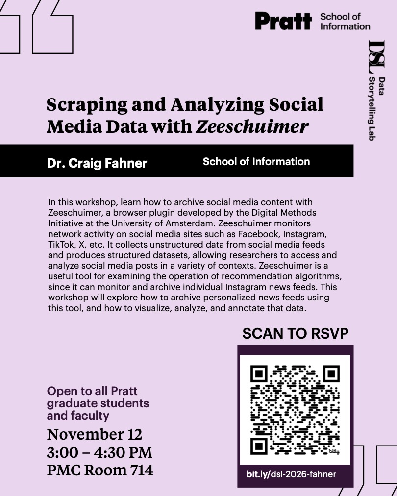

## Week 11 activities: 

* [Lecture notebook: Geocodes and locations](https://github.com/craigfahner/INFO-664/blob/main/week11/week11_scratch.ipynb)
* [Lecture notebook: layering data on maps](week11_part2_scratch.ipynb)

* In-progress project "pitch" presentations

## Optional: [Scraping and Analyzing Social Media Data workshop](assets/dsl.pdf)

November 12, 3:00 – 4:30 PM, PMC Room 714. Rsvp [here](bit.ly/dsl-2026-fahner)

## HOMEWORK:

In the following two weeks, you will be developing your analysis into a presentation as a Github pages site, which will synthesize your data, code, visual artefacts, and findings into a streamlined narrative. 

Have a look at the [existing projects from the course](https://gofilipa.github.io/664-projects/) and the [documentation requirements](https://craigfahner.github.io/INFO-664/final/) for the final project. 

For this week's homework, outline the "story" you want to tell through your documentation. 

- How will you introduce the subject matter?
- How will you describe your process? Rather than conveying your process in procedural detail, how will you summarize the major components?
- How much of the data / analysis / code will you embed in your GitHub pages site? And what will you link to on separate pages?
- What visual elements are important to include? 

Create an outline (using Markdown in a jupyter notebook) that you can expand on as you begin to develop your GitHub pages site over the coming weeks.